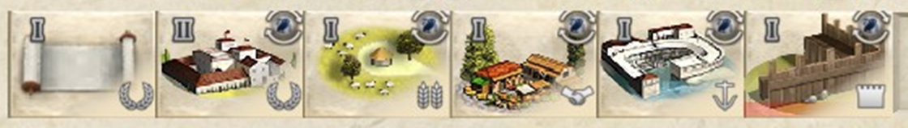

# RR Turbo in RIS

With [RR Turbo](/RTR-Imperium-Surrectum/ris-wiki/wiki/RR-Turbo) started normally, RIS reads its own Turbo versions of the campaign files. They hold the rules below, in every RIS campaign. The speed-only start and a game without RR Turbo play plain RIS.

## The AI plays by your rules

- **Buildings and recruitment:** AI factions build and recruit under the same rules as the player. They plan their buildings for the long term (income, growth, what each building opens and closes, how soon it pays for itself), set their taxes, aim for their faction's usual army and raise armies when at war.
- **Governments from the start:** every faction starts with its [governments](/RTR-Imperium-Surrectum/ris-wiki/wiki/government) in place, not only the player's.
- **Supply:** horse and camel supply, weapon and armour levels and industry levels count for every faction.
- **[Empire size](/RTR-Imperium-Surrectum/ris-wiki/wiki/Empire-size):** buildings cost an AI faction the same income they cost the player.
- **[Areas of recruitment](/RTR-Imperium-Surrectum/ris-wiki/wiki/aor):** the AI recruits area-of-recruitment units, at half the priority of its own faction units. In plain RIS it never does.

## Capturing a town

- **Government and treasury** are destroyed whenever a town changes hands, whoever takes it. Build a new government at once.
- **Garrison buildings** are destroyed at every capture, not only the player's.
- **Last family member:** the faction that kills another faction's last family member, in battle or by assassination, takes all its remaining towns instead of the rebels. Order there starts with a penalty, *Old population hates you*, that shrinks each turn. A death with no killer (old age) goes as in the game.

## Converting buildings

- **Repair & Convert:** a building of another culture that your culture can also build appears in the town's Repair list, now headed *Repair & Convert*. Converted, it becomes yours at the same level, with your culture's look and the culture penalty eased, for a quarter of the level's price and in the level's build time.
- On the town's building cards, a building you can convert shows the emblem of the faction that built it inside two circular arrows, in place of the game's red other-culture triangle.

- The [Region Information Scroll](/RTR-Imperium-Surrectum/ris-wiki/wiki/buildings-hinterland_region) becomes your culture's as soon as you hold the town.

## Governments and health

- **Changing government without demolishing:** a town's other [governments](/RTR-Imperium-Surrectum/ris-wiki/wiki/government) are listed beside the standing one with a swap sign. A change costs the new government less the current one (never below nothing, no money back), and the old one keeps working until the new one stands. Water supply and hospitals swap the same way.

## Liberation

- The [liberation](/RTR-Imperium-Surrectum/ris-wiki/wiki/buildings-liberation) building's text names the faction that would get the town, worked out the way the game picks a revolting town's new owner.
- **Liberate** is offered only when the people it would free are dead and can rise again; otherwise only **Abandon**.

## Wars and diplomacy

- **No war timer:** AI wars no longer end on the game's war timer (peace after 21 turns unless ahead, always after 41). RIS's own script that set every war to neutral and back each 20 turns, which also lifted sieges, is gone.
- **War goals:** each AI faction has towns it wants, and goes to war with their neutral owners. The nearest goal keeps an attack alive across several turns.
- An AI faction no longer wishes for peace with an enemy its armies already outnumber.
- A faction killed off that can re-emerge stays *dead until resurrected*, so the campaign script can bring it back.

## The campaign AI

**Attacks**
- Counts the town's garrison, its walls and enemy armies nearby before setting off.
- Goes for enemy field armies near its target and while besieging.
- Gathers, sets off and besieges in the same turn; an army that hired mercenaries can still move.
- Sends its nearest capable army at invaders on its land and breaks sieges.

**Sieges**
- Weighs storming now against starving the town out; storms a faction's last town sooner.
- Keeps a siege when other enemy armies arrive, and reinforces besiegers.
- Besieged garrisons without a general sally when it pays.

**Armies**
- Towns keep enough garrison to hold their public order.
- Factions with large garrisons split the surplus into field armies, one attack at a time.
- Small armies join a bigger one nearby; depleted units merge, retrain or are disbanded.
- Every gathering campaign actually marches; gathering armies are no longer frozen by other orders.
- Recruits generals for ungoverned towns and large armies led by captains.
- Chooses occupy, enslave or exterminate by what the town is worth.

**Navies**
- Weighs walking against sailing, with its own fleets or ones it can build, and the risk from enemy fleets.
- Ships armies from quiet home areas to fronts across the sea.
- Plans sea invasions from its strongest land block, finishes an island before sailing for a new shore, and targets rebel towns and rebel islands.
- A fleet carrying armies with nowhere to land unloads at the nearest own region.

**Characters**
- Picks governors by what their traits give a town, and sends idle generals to train.

## Factions and campaigns

- **Corsi and Sardinians:** they make attack plans (the Sardinians more than the Corsi), and their AI recruits no warships and holds its islands.
- **Four Romans:** Carthage and its Numidian protectorates keep the peace; the war over Sicily and the islands comes from play, not from scripted wars; Carthage starts with field armies in Spain.

## On the campaign map

- Each faction flies its own flag on the campaign map. Plain RIS shows culture flags for many factions, because the game cannot hold more than 500 such models; RR Turbo lifts that limit.
- Honey looks like the beekeeping of the people where it lies: cork hives in Iberia and North Africa, terracotta hives in the Greek world, clay hives in a mud wall in the east, log hives in the north.
- Agent limits per settlement and RIS's own building icons work.
