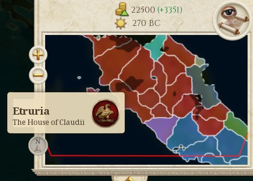

# RR Turbo

RR Turbo is a launcher for Total War: ROME REMASTERED that speeds the game up, fixes crashes and freezes, gives the campaign AI a stronger game and switches on the RIS rules made for games played with it. Without RR Turbo, RIS plays as a normal mod.

**[Download RR Turbo 1.0](https://github.com/Tarnholm/Turbo/releases/latest/download/RRTurbo.exe)** · [Project page](https://github.com/Tarnholm/Turbo)

RR Turbo is not made by or affiliated with Feral Interactive, SEGA or Creative Assembly. **Never use it in multiplayer battles.**

## Starting the game

- **RRTurbo.exe:** everything: the speed-ups, the fixes, the stronger campaign AI and the [RIS rules for RR Turbo](/RTR-Imperium-Surrectum/ris-wiki/wiki/RR-Turbo-in-RIS).
- **RRTurbo.exe --speed:** the speed-ups only. The campaign plays exactly like plain RIS, just faster.
- **Steam, without RR Turbo:** plain RIS.

The mode is chosen when the game starts; to switch, close the game and start it the other way.

## Install

1. Put **RRTurbo.exe** in a folder of its own, e.g. `C:\Games\RRTurbo` (outside OneDrive).
2. Windows Security may quarantine it, because it loads a file into the game the way some malware does. Add two folders as exclusions: the one holding RRTurbo.exe and `%LOCALAPPDATA%\RRTurbo` (Windows Security › Virus & threat protection › Manage settings › Exclusions › Add an exclusion › Folder).
3. Make a desktop shortcut to RRTurbo.exe.
4. In Feral's start window, untick **Pause game on suspend**, or AI turns stop while the game is in the background.

Start the shortcut and press **PLAY**. RR Turbo starts the game through Steam and loads itself once Feral's window is up. Your mod selection stays as chosen.

A new version is offered in the launcher when one is out; updating keeps every setting you changed. **Uninstall** under PLAY removes RR Turbo and its files; the game, saves and mods are not touched.

## Diagnostics

At the first start the launcher asks whether to send diagnostics to the RIS team. With **Send**, the RIS Crash Reporter starts with the game and, when the game closes or crashes, sends the RIS team the game's logs, your RR Turbo settings, your latest save, any crash files, your Windows version, graphics card and your RIS Discord name. With **Don't send**, nothing leaves your PC. **Diagnostics** under PLAY changes the answer.

Crashes with RR Turbo loaded go to the RIS team, not to Feral: Feral's crash reporter cannot know RR Turbo was running.

## Faster

- **AI turns:** no frame-rate cap and a higher speed cap while the AI moves, shorter waits between factions, no background sleep, and the AI's slowest checks (march routes, movement ranges, faction strength, victory conditions) worked out once and reused while nothing they depend on has changed.
- **Loading:** the campaign's files are read ahead on several threads, start-up file checks are answered from folder listings, and loading screens are not held to the frame-rate cap. Battles pre-open the files earlier battles used.
- **Saves:** written through a large buffer, with the fog-of-war tables written faster (the same bytes as the game).
- **Memory:** fog-of-war tables and empty memory pages leave RAM while they are not needed.

The results are the same as the game's; only the waiting is shorter.

## Crash and freeze fixes

Each acts only where the game would otherwise crash, freeze or leak memory:

- a faction whose last character dies in battle finishes dying instead of freezing the campaign
- an AI turn that keeps repeating orders that change nothing on the map ends
- dead units and stray bodyguards are taken out of army lists before saving
- armies deleted during AI turns, AI merges toward a general who is still moving, and dead hordes no longer crash the game
- a building destroyed while a ship is queued in it, adoption or marriage answers with no message tab open, and long sessions (the interface image cache) no longer crash
- hovering a building card no longer freezes the game
- more than 500 resource and strategy-map models can be shown; the game crashes at 501
- garbled names from overflowing shared texts are prevented
- memory leaks in news-message unit cards and faction tooltips are closed
- an audio device change no longer deadlocks the sound
- an heir who comes of age while the leader's army is full joins another army

## Interface

- **Minimap** half as large again, with three extra zoom steps (4×, 8×, 16×).
- **Top-right corner:** season and year, then the treasury, on one row.
- **Seasons:** the season icon follows RIS's four turns a year:    
- **F1 and the "?" buttons** open this wiki in the game. The "?" buttons show your faction's emblem.
- **Choose faction:** factions in folding sections by culture, five to a row.
- **Building browser:** every government chain in the Government section, and one row per branch for chains that branch.
- **Hourglass badges** show the real number of turns from 10 up instead of "9+".
- **Character panels:** no loyalty points.
- **Custom battles:** a fourth row of unit cards, culture sections for the factions, and a unit panel with the stats in one column and a larger card.
- **"Revolt Suppressed"** messages only for your own shadow factions.
- No short-campaign toggle on the choose-faction screen.
- RIS's "reload your save" reminder never fires.

## Desktop

- A game in the background no longer grabs the mouse, jumps to the front or sends stray characters to other programs.
- Keys held when the game loses focus are released.

## Graphics

- **Upscaler:** below 100 % Resolution Scale in the game's graphics settings, the game's own stretch is replaced by NVIDIA DLSS on GeForce RTX cards, or AMD FSR 3.1 / 4 on other DirectX 12 cards (FSR 2.2 on older ones). The files come straight from NVIDIA's and AMD's own GitHub, signature-checked and kept up to date. At 100 % nothing changes.
- **ReShade:** Modder settings › ReShade downloads ReShade from reshade.me and turns it on or off.

## Settings

Most players only press PLAY. **Modder settings** in the launcher lists every setting in groups (speed, fixes, AI, interface, upscaler), each with a switch and a reset to the value RR Turbo ships with. Gold marks a value you changed; blue, one set by a mod.
